# SkillLoop Entity-Relationship (ER) Architecture

This document defines the relational database architecture for **SkillLoop**, modeled in Third Normal Form (3NF) with strict referential integrity, check constraints, composite keys, and indexing strategy.

```mermaid
erDiagram
    USERS ||--o{ USER_SKILLS : "has"
    USERS ||--o{ USER_AVAILABILITY : "defines"
    USERS ||--o{ LEARNING_GOALS : "sets"
    USERS ||--o{ POSTS : "authors"
    USERS ||--o{ POST_COMMENTS : "writes"
    USERS ||--o{ POST_REACTIONS : "reacts"
    USERS ||--o{ RESOURCES : "uploads/shares"
    USERS ||--o{ RESOURCE_RATINGS : "rates"
    USERS ||--o{ RESOURCE_COMPLETIONS : "completes"
    USERS ||--o{ RESOURCE_BOOKMARKS : "bookmarks"
    USERS ||--o{ TEACHING_OFFERS : "offers"
    USERS ||--o{ LEARNING_SESSIONS : "teaches/learns"
    USERS ||--o{ SESSION_REVIEWS : "submits"
    USERS ||--|| CREDIT_ACCOUNTS : "owns"
    USERS ||--o{ CREDIT_TRANSACTIONS : "participates"
    USERS ||--o{ TEAM_MEMBERS : "belongs_to"
    USERS ||--o{ TEAM_APPLICATIONS : "applies"
    USERS ||--o{ PROJECT_MEMBERS : "collaborates"
    USERS ||--o{ PROJECT_TASKS : "assigned"
    USERS ||--o{ CHALLENGE_SUBMISSIONS : "submits"
    USERS ||--o{ NOTIFICATIONS : "receives"

    SKILL_CATEGORIES ||--o{ SKILLS : "categorizes"
    SKILLS ||--o{ SKILL_RELATIONSHIPS : "source_skill"
    SKILLS ||--o{ SKILL_RELATIONSHIPS : "target_skill"
    SKILLS ||--o{ USER_SKILLS : "master_skill"
    SKILLS ||--o{ RESOURCES : "tagged_with"
    SKILLS ||--o{ TEACHING_OFFERS : "teaches"
    SKILLS ||--o{ TEAM_OPENINGS : "requires"
    SKILLS ||--o{ PROJECT_SKILLS : "utilizes"
    SKILLS ||--o{ CHALLENGE_SKILLS : "tests"

    COMPETITIONS ||--o{ TEAMS : "hosts"
    TEAMS ||--o{ TEAM_MEMBERS : "contains"
    TEAMS ||--o{ TEAM_OPENINGS : "lists"
    TEAM_OPENINGS ||--o{ TEAM_APPLICATIONS : "receives"

    PROJECTS ||--o{ PROJECT_MEMBERS : "has"
    PROJECTS ||--o{ PROJECT_SKILLS : "uses"
    PROJECTS ||--o{ PROJECT_TASKS : "tracks"
    PROJECTS ||--o{ PROJECT_MILESTONES : "schedules"

    CREDIT_ACCOUNTS ||--o{ CREDIT_TRANSACTIONS : "ledgers"
    LEARNING_SESSIONS ||--o{ SESSION_REVIEWS : "reviewed_by"

    CHALLENGES ||--o{ CHALLENGE_SKILLS : "tags"
    CHALLENGES ||--o{ CHALLENGE_SUBMISSIONS : "evaluates"

    POSTS ||--o{ POST_COMMENTS : "has"
    POSTS ||--o{ POST_REACTIONS : "receives"
    RESOURCES ||--o{ RESOURCE_RATINGS : "evaluated_by"
    RESOURCES ||--o{ RESOURCE_COMPLETIONS : "marked_by"
    RESOURCES ||--o{ RESOURCE_BOOKMARKS : "saved_by"
```

## Relational Summary Table

| Category | Primary Entities | Key Relationships & Integrity Constraints |
| :--- | :--- | :--- |
| **Auth & Identity** | `users`, `roles`, `user_roles`, `user_privacy_settings` | `email` & `username` UNIQUE. Cascade delete on authentication cleanup. |
| **Skill Graph** | `skill_categories`, `skills`, `skill_relationships`, `user_skills`, `learning_goals` | Composite PK on `user_skills(user_id, skill_id)`. Self-referential graph with cycle prevention. |
| **Knowledge Hub** | `resources`, `resource_ratings`, `resource_completions`, `resource_bookmarks` | Composite PK on `resource_bookmarks(user_id, resource_id)`. Rating check constraint: `rating >= 1 AND rating <= 5`. |
| **Social Feed** | `posts`, `post_comments`, `post_reactions`, `post_tags` | Unique reaction constraint `(post_id, user_id)`. Self-referential `parent_id` for comments. |
| **Exchange & Ledger** | `teaching_offers`, `learning_sessions`, `session_reviews`, `credit_accounts`, `credit_transactions` | Double-entry ledger with atomic balance snapshots and foreign key reference to settled session. |
| **Competitions & Teams**| `competitions`, `teams`, `team_members`, `team_openings`, `team_applications` | Capacity check: `members_count <= max_members`. Concurrency-safe slot occupancy checks. |
| **Projects & Kanban** | `projects`, `project_members`, `project_skills`, `project_tasks`, `project_milestones` | Task states: `TODO`, `IN_PROGRESS`, `BLOCKED`, `DONE`. Unique project membership. |
| **Challenges & XP** | `challenges`, `challenge_submissions`, `xp_transactions` | Submission state verification before XP distribution. |
| **Platform & Trust** | `notifications`, `reports`, `audit_logs` | Immutable audit log trail for system security events. |
